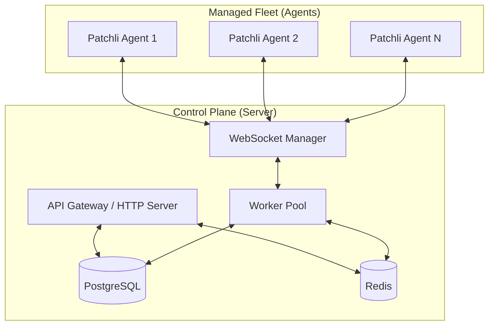
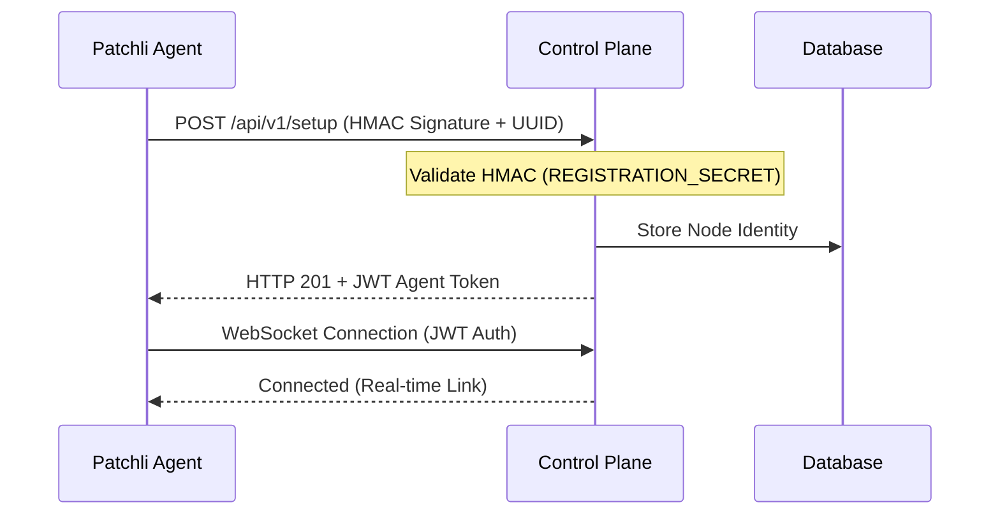

#  Patchli

[](https://github.com/arumes31/patchli/actions/workflows/ci.yml)
[](https://github.com/arumes31/patchli/actions/workflows/cd.yml)
[](https://goreportcard.com/report/github.com/arumes31/patchli)
[](https://opensource.org/licenses/MIT)

### Distributed Linux Patch Management & Fleet Monitoring System

Patchli is a high-performance, distributed Patch Management system designed to seamlessly orchestrate updates across massive fleets of Linux and Windows nodes. It provides a centralized Control Plane for monitoring, scheduling, and executing updates with a focus on reliability, security, and real-time observability.

---

## 🏗️ Architecture

Patchli follows a robust client-server architecture. The **Control Plane** manages the fleet state and orchestrates jobs, while lightweight **Agents** execute tasks locally on each node.



---

## 🔐 Zero-Touch Registration

Agents register themselves securely using an HMAC-signed setup script. Once registered, they receive a persistent JWT for all future communications.

- Each setup script carries a server-generated nonce that can be redeemed **once**, within 10 minutes. Generate a new script per node.
- Tokens are never issued for a node ID that still holds a valid refresh token. To re-enroll a reinstalled node, wait for its refresh token to expire (7 days) or revoke it in the `refresh_tokens` table.
- The WebSocket binds the node identity to the access token subject; heartbeats reporting a different node ID are rejected. Refresh tokens are single-use and reuse revokes all tokens of the node.



---

## ✨ Key Features

- **🚀 Performance**: Go-based architecture with gRPC-ready design and non-blocking worker pools.
- **🛡️ Resilience**: Self-healing watchdog, HTTP long-polling fallback, and state recovery after reboots.
- **📦 Multi-OS Support**: Native support for **APT** (Debian/Ubuntu), **APK** (Alpine), **DNF/YUM** (RHEL/Rocky), **Pacman** (Arch), **Zypper** (SUSE), and **WUA** (Windows).
- **🔒 Security**: HMAC-based zero-touch registration, JWT persistent authentication, and pre-patch lock checks.
- **🛠️ Orchestration**: Maintenance windows, pre/post-patch scripts, and remote health checks.
- **📈 Observability**: Real-time log streaming via WebSockets and detailed fleet metrics.

---

## ⚙️ Configuration Reference

### Control Plane (Server)

| Variable | Description | Default | Required |
| :--- | :--- | :--- | :--- |
| `DB_URL` | PostgreSQL connection string (`postgres://...`) | - | **Yes** |
| `REDIS_URL` | Redis connection string; Docker Compose builds it from `REDIS_PASSWORD` | - | **Yes** |
| `PORT` | Listening port for the API and Dashboard | `8080` | No |
| `JWT_SECRET` | Secret key for signing Agent authentication tokens | - | **Yes** |
| `REGISTRATION_SECRET` | Secret key for generating HMAC setup signatures | - | **Yes** |
| `BASE_URL` | External URL of the server (e.g., `https://patch.example.com`). Always set it in production; without it the URL is derived from the request `Host` header | `http://localhost:8080` | No |
| `ADMIN_TOKEN` | High-entropy bearer token for the admin API (`/api/v1/nodes`, `/api/v1/stats`, `/api/v1/setup`). The admin API returns 401 while unset | - | No |
| `TRUSTED_PROXY` | IP of a reverse proxy whose `X-Forwarded-Proto` header is trusted | - | No |
| `COMMAND_SIGNING_KEY` | Base64 Ed25519 private key (32-byte seed) used to sign agent commands | - | No |

In Docker Compose, PostgreSQL and Redis are only published on `127.0.0.1`, and
Redis requires `REDIS_PASSWORD`.

### Intelligent Agent

| Flag | Description |
| :--- | :--- |
| `--verify` | Performs self-diagnosis (identity, PM detection, network) and exits. |

| Variable | Description | Default |
| :--- | :--- | :--- |
| `SERVER_URL` | Control-plane URL, optionally including a path prefix; remote hosts require HTTPS with a certificate trusted by the system | `localhost:8080` |
| `TRUSTED_PUB_KEY` | Ed25519 public key (Base64) that signs agent release manifests for self-update | - |
| `COMMAND_PUB_KEY` | Ed25519 public key (Base64) matching the server's `COMMAND_SIGNING_KEY`. When set, the agent only executes commands signed for its own node ID that have not expired | - |

Bare remote host names use HTTPS; the agent uses WSS for the corresponding
WebSocket connection. Explicit HTTP is accepted only for loopback development
controllers. Remote deployments previously using plain HTTP must configure TLS
before updating the agent. Redirects are rejected so credentials and update
requests cannot be forwarded to another endpoint.

#### Command signing

Without `COMMAND_PUB_KEY`, the agent executes every command (including
pre/post-patch scripts) that its authenticated control plane sends, as
root/SYSTEM. To limit the impact of a compromised or impersonated control
plane, generate a key pair, set `COMMAND_SIGNING_KEY` on the server and
`COMMAND_PUB_KEY` on every agent:

```bash
openssl genpkey -algorithm ed25519 -out command-key.pem
openssl pkey -in command-key.pem -outform DER | tail -c 32 | base64          # COMMAND_SIGNING_KEY
openssl pkey -in command-key.pem -pubout -outform DER | tail -c 32 | base64  # COMMAND_PUB_KEY
```

Keep `command-key.pem` and `COMMAND_SIGNING_KEY` secret. Commands are bound to the target node and
expire after 15 minutes. Commands received over an unauthenticated poll are
never executed.

#### Self-update

The agent downloads `/download/agent.manifest`, a JSON document
`{"version","os","arch","sha256","size"}`, and its Base64 Ed25519 signature
`/download/agent.manifest.sig` (made with the key matching `TRUSTED_PUB_KEY`).
It then downloads `/download/agent`, reading at most `size` bytes, and checks the
SHA-256. Updates to a version that is not newer than the running agent are
refused. Build agents with `-ldflags "-X main.Version=<version>"` (the agent
Dockerfile accepts `--build-arg VERSION=<version>`); development builds report
`dev` and accept any signed version.

---

## 🚀 Getting Started

### 1. Deploy the Control Plane
The easiest way to start is using Docker Compose:

```bash
docker-compose up -d
```

### 2. Access the Dashboard
Navigate to `http://localhost:8080/` and log in.

### 3. Add Your First Agent
1. Go to the **Add Agent** section.
2. Select your OS (Linux, Alpine, or Windows).
3. Copy the generated one-liner and run it on your target node with
   `PATCHLI_ADMIN_TOKEN` set to the server's `ADMIN_TOKEN` (the setup endpoint
   requires it). Each generated script registers a single node.
4. The node will appear in the dashboard automatically.

---

## 🛠️ Development

### Local Setup
```bash
# Run server
cd server && go run ./cmd/patchli-server/main.go

# Run agent
cd agent && go run ./cmd/patchli-agent
```

### Testing & Quality
We maintain a strict quality standard with **80% code coverage** enforcement.

```bash
# Run all tests
go test ./... -cover

# Run security scan
gosec ./...
```

---

## 📄 License
Patchli is released under the [MIT License](LICENSE).
```bash
# Run all tests
go test ./... -cover

# Run security scan
gosec ./...
```

---

## 📄 License
Patchli is released under the [MIT License](LICENSE).
