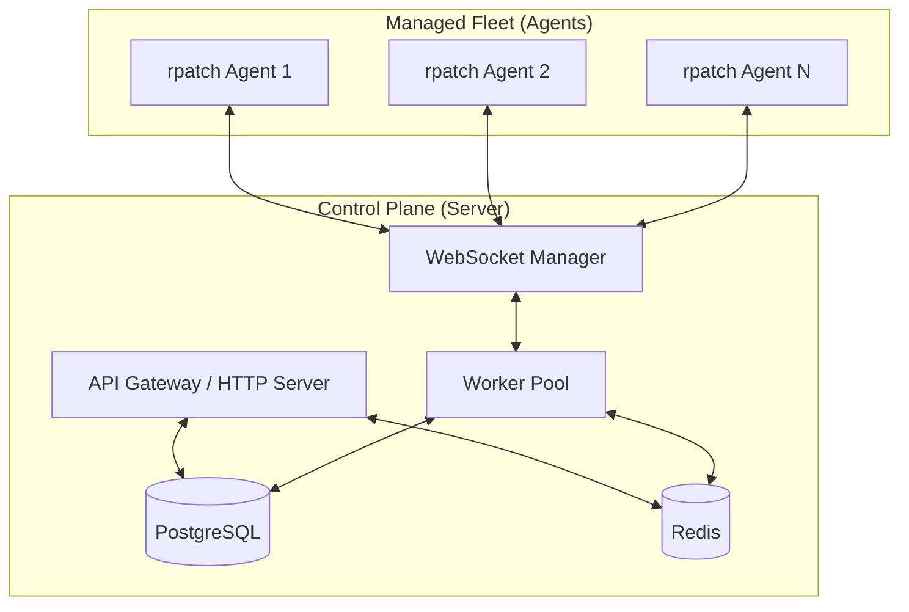
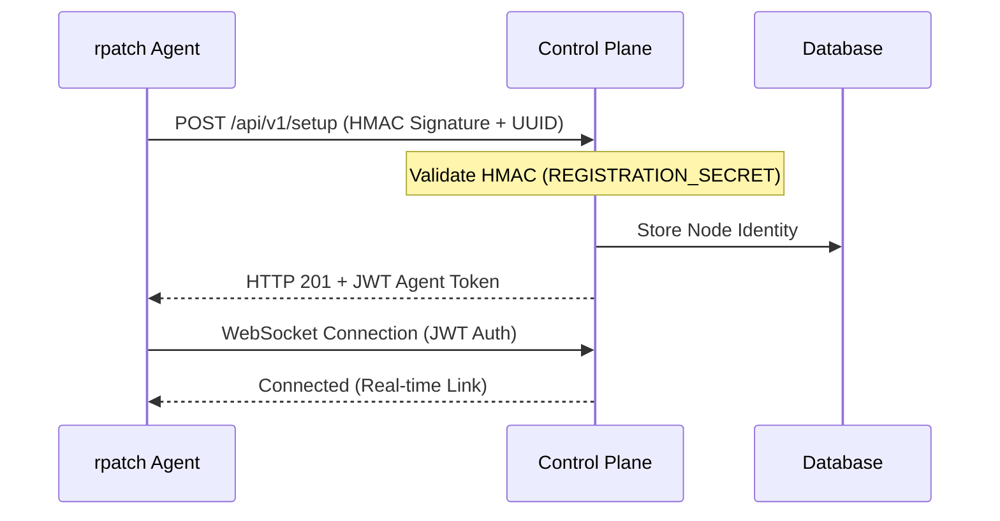

#  rpatch

[](https://github.com/arumes31/rpatch/actions/workflows/ci.yml)
[](https://github.com/arumes31/rpatch/actions/workflows/cd.yml)
[](https://goreportcard.com/report/github.com/arumes31/rpatch)
[](https://opensource.org/licenses/MIT)

### Distributed Linux Patch Management & Fleet Monitoring System

rpatch is a high-performance, distributed Patch Management system designed to seamlessly orchestrate updates across massive fleets of Linux and Windows nodes. It provides a centralized Control Plane for monitoring, scheduling, and executing updates with a focus on reliability, security, and real-time observability.

> **Status:** renamed from patchli. Not production-ready yet: see [docs/PLAN.md](docs/PLAN.md) for the completeness check, UI concept and roadmap.

---

## 🏗️ Architecture

rpatch follows a robust client-server architecture. The **Control Plane** manages the fleet state and orchestrates jobs, while lightweight **Agents** execute tasks locally on each node.



---

## 🔐 Zero-Touch Registration

Agents register themselves securely using an HMAC-signed setup script. Once registered, they receive a persistent JWT for all future communications.

- Each setup script carries a server-generated nonce that can be redeemed **once**, within 5 minutes. Generate a new script per node.
- Enrollment claims the node ID. Tokens are never issued again for a claimed node ID, including while its refresh token is being rotated or after reuse revocation. The claim is extended on every refresh and expires 7 days after the last one. To re-enroll a reinstalled node, wait for the claim to expire or revoke it with the admin API:
  ```bash
  curl -fsS -X POST -H "Authorization: Bearer $ADMIN_TOKEN" -d '{"mac":"<node-id>"}' https://patch.example.com/api/v1/nodes/revoke
  ```
- Revoking an enrollment also closes the node's live WebSocket, and `/ws` refuses nodes without a current enrollment, so a revoked node's still-unexpired access token cannot reconnect.
- The WebSocket binds the node identity to the access token subject; heartbeats reporting a different node ID are rejected. Refresh tokens are single-use and reuse revokes all tokens of the node. Enrollment, rotation and revocation are serialized per node, so a replacement issued by a concurrent refresh cannot survive a reuse revocation.
- The setup page and scripts require an HTTPS `BASE_URL` (plain HTTP only for `localhost`/loopback). The generated install commands pin HTTPS, fail on HTTP errors and do not follow redirects.



---

## ✨ Key Features

- **🚀 Performance**: Go-based architecture with gRPC-ready design and non-blocking worker pools.
- **🛡️ Resilience**: Agents reconnect on their own, keep job results until the controller received them, and report jobs interrupted by a restart.
- **📦 Multi-OS Support**: Native support for **APT** (Debian/Ubuntu), **APK** (Alpine), **DNF/YUM** (RHEL/Rocky), **Pacman** (Arch), **Zypper** (SUSE), and **WUA** (Windows).
- **🔒 Security**: HMAC-based zero-touch registration, JWT persistent authentication, and pre-patch lock checks.
- **🛠️ Orchestration**: Maintenance windows, pre/post-patch scripts, and remote health checks.
- **📈 Observability**: Real-time log streaming via WebSockets and detailed fleet metrics.

---

## ⚙️ Configuration Reference

### Control Plane (Server)

| Variable | Description | Default | Required |
| :--- | :--- | :--- | :--- |
| `DB_URL` | PostgreSQL connection string (`postgres://...`) | - | **Yes** |
| `REDIS_URL` | Redis connection string; Docker Compose builds it from `REDIS_PASSWORD` | - | **Yes** |
| `PORT` | Listening port for the API and Dashboard | `8080` | No |
| `JWT_SECRET` | Secret key for signing Agent authentication tokens | - | **Yes** |
| `REGISTRATION_SECRET` | Secret key for generating HMAC setup signatures | - | **Yes** |
| `BASE_URL` | External URL of the server (e.g., `https://patch.example.com`). Always set it in production; without it the URL is derived from the request `Host` header. Must use HTTPS unless the host is loopback | `http://localhost:8080` | No |
| `ADMIN_TOKEN` | High-entropy secret (e.g. `openssl rand -hex 32`). Scripts send it as `Authorization: Bearer` to the admin API; in the web UI you sign in with it once and get a 12-hour HttpOnly session cookie (login is limited to 5 attempts per minute). Admin API and UI are locked while unset | - | **Yes** |
| `TLS_CERT_FILE` / `TLS_KEY_FILE` | PEM certificate and key; when both are set the server serves HTTPS (TLS 1.2+). Agents require HTTPS, so set these unless a TLS reverse proxy fronts the server | - | No |
| `TRUSTED_PROXY` | IP of a reverse proxy whose `X-Forwarded-Proto` header is trusted | - | No |
| `COMMAND_SIGNING_KEY` | Base64 Ed25519 private key (32-byte seed) used to sign agent commands | - | No |
| `DISCORD_WEBHOOK_URL` | Discord webhook URL for fleet alerts and job notifications | - | No |
| `SLACK_WEBHOOK_URL` | Slack incoming webhook URL for fleet alerts and job notifications | - | No |
| `TEAMS_WEBHOOK_URL` | Microsoft Teams webhook URL for fleet alerts and job notifications | - | No |

In Docker Compose, PostgreSQL and Redis are only published on `127.0.0.1`, and
Redis requires `REDIS_PASSWORD`.

### Intelligent Agent

| Flag | Description |
| :--- | :--- |
| `--verify` | Performs self-diagnosis (identity, PM detection, network) and exits. |
| `--enroll` | Redeems the installer's one-time registration grant (`RPATCH_GROUP`, `RPATCH_TIMESTAMP`, `RPATCH_NONCE`, `RPATCH_SIGNATURE`) and stores the tokens. Does nothing if the agent is already enrolled. |

| Variable | Description | Default |
| :--- | :--- | :--- |
| `SERVER_URL` | Control-plane URL, optionally including a path prefix. Requires HTTPS with a certificate trusted by the system | `localhost:8080` |
| `ALLOW_INSECURE_LOOPBACK` | `true` permits an explicit `http://` loopback `SERVER_URL` for local development. Requires `COMMAND_PUB_KEY` | - |
| `TRUSTED_PUB_KEY` | Ed25519 public key (Base64) that signs agent release manifests for self-update | - |
| `COMMAND_PUB_KEY` | Ed25519 public key (Base64) matching the server's `COMMAND_SIGNING_KEY`. When set, the agent only executes commands signed for its own node ID that have not expired | - |

Bare host names (including `localhost`) use HTTPS; the agent uses WSS for the
corresponding WebSocket connection. Plain HTTP cannot prove that the listener
is the controller, so any local process bound to the port would receive the
agent's tokens. It is therefore refused unless the URL is an explicit
`http://` loopback address, `ALLOW_INSECURE_LOOPBACK=true` is set and
`COMMAND_PUB_KEY` is configured; the agent exits at startup otherwise.
Deployments previously using plain HTTP must configure TLS before updating the
agent. Redirects are rejected so credentials and update requests cannot be
forwarded to another endpoint.

#### Command signing

Without `COMMAND_PUB_KEY`, the agent executes every command (including
pre/post-patch scripts) that its TLS-authenticated control plane sends, as
root/SYSTEM. To limit the impact of a compromised or impersonated control
plane, generate a key pair, set `COMMAND_SIGNING_KEY` on the server and
`COMMAND_PUB_KEY` on every agent:

```bash
openssl genpkey -algorithm ed25519 -out command-key.pem
openssl pkey -in command-key.pem -outform DER | tail -c 32 | base64          # COMMAND_SIGNING_KEY
openssl pkey -in command-key.pem -pubout -outform DER | tail -c 32 | base64  # COMMAND_PUB_KEY
```

Keep `command-key.pem` and `COMMAND_SIGNING_KEY` secret. Commands are bound to the target node and
expire after 15 minutes. The installer copies the public key from the server automatically.

#### Self-update

The agent downloads `/download/agent.manifest`, a JSON document
`{"version","os","arch","sha256","size"}`, and its Base64 Ed25519 signature
`/download/agent.manifest.sig` (made with the key matching `TRUSTED_PUB_KEY`).
It then downloads `/download/agent`, reading at most `size` bytes, and checks the
SHA-256. Updates to a version that is not newer than the running agent are
refused. Build agents with `-ldflags "-X main.Version=<version>"` (the agent
Dockerfile accepts `--build-arg VERSION=<version>`); development builds report
`dev` and accept any signed version.

---

## 🚀 Getting Started

### 1. Deploy the Control Plane
The easiest way to start is using Docker Compose:

```bash
docker-compose up -d
```

### 2. Access the Dashboard
Navigate to `http://localhost:8080/` and log in.

### 3. Add hosts
Open **Add host**, set `RPATCH_ADMIN_TOKEN` on the host and run the shown
command as root:

```bash
curl --proto '=https' --tlsv1.2 -fsS -H "Authorization: Bearer $RPATCH_ADMIN_TOKEN" \
  "https://patch.example.com/api/v1/setup?group=default&os=linux" | sudo sh
```

The installer is a POSIX `sh` script for Debian, Ubuntu and Alpine (systemd
or OpenRC, amd64 or arm64). It downloads the agent binary from the server
(`/download/rpatch-agent-linux-<arch>`, built into the server image), writes
`/etc/rpatch/agent.env`, enrolls with the one-time grant (valid for 5 minutes)
and starts the `rpatch-agent` service. Re-running it upgrades the agent and
keeps the enrollment. The host appears on the Fleet page within seconds.

---

## 🗓️ Patch window & reboots

- Every day the scheduler runs the window configured under **Settings**
  (default 03:00–05:30 Europe/Vienna). Hosts are patched **one at a time** in
  slot order (lower slot first; set per host on the Fleet page).
- A host is rebooted after patching only when the update requires it
  (`/var/run/reboot-required` on Debian/Ubuntu, a replaced kernel on Alpine)
  and its **auto-reboot** policy is on. The reboot counts as done when the
  host reconnects with a new boot ID (timeout 15 minutes).
- Excluded and offline hosts are skipped. No new host is started in the last
  10 minutes of the window. After two consecutive failures the window stops and
  a `window_paused` webhook is sent; every window ends with a
  `window_summary` webhook (Discord, Slack, Teams).
- Put the control-plane host in the last slot. When it reboots itself, the
  window resumes after the restart: hosts already patched in this window are
  counted as done, and the pending reboot is confirmed when its agent returns.
- Apt runs `apt-get update` and `apt-get upgrade --with-new-pkgs` (new
  kernels included, nothing removed) and keeps local config files. Upgrading
  Docker restarts the host's containers regardless of the reboot policy.

## 🔌 Admin API

All endpoints accept the UI session cookie or `Authorization: Bearer $ADMIN_TOKEN`.

| Method & path | Purpose |
| :--- | :--- |
| `GET /api/v1/nodes` | Hosts with status, pending updates, policy |
| `GET /api/v1/stats` | Fleet totals |
| `POST /api/v1/nodes/{id}/action` | `{"action":"check_updates"\|"apply_updates"\|"reboot"}` |
| `PUT /api/v1/nodes/{id}/policy` | `{"auto_reboot":true,"excluded":false,"slot":100}` |
| `GET /api/v1/jobs?node=&limit=` / `GET /api/v1/jobs/{id}` | Job history / one job with output |
| `GET`/`PUT /api/v1/settings` | `{"window_start":"03:00","window_end":"05:30","timezone":"Europe/Vienna","enabled":true}` |
| `GET /api/v1/window` / `POST /api/v1/window/run` | Window status / start a window now |
| `GET /api/v1/setup?os=linux&group=` | Installer with a fresh one-time grant |
| `POST /api/v1/nodes/revoke` | `{"mac":"<node-id>"}` removes a host's enrollment |

---

## 🛠️ Development

### Local Setup
```bash
# Run server
cd server && go run ./cmd/rpatch-server/main.go

# Run agent
cd agent && go run ./cmd/rpatch-agent
```

### Testing & Quality
We maintain a strict quality standard with **80% code coverage** enforcement.

```bash
# Run all tests
go test ./... -cover

# Run security scan
gosec ./...
```

---

## 📄 License
rpatch is released under the [MIT License](LICENSE).

